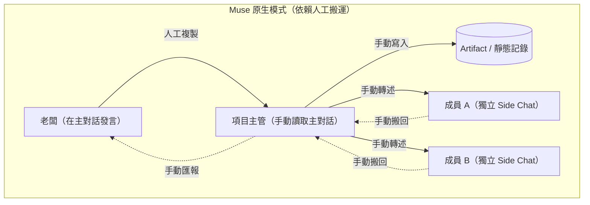
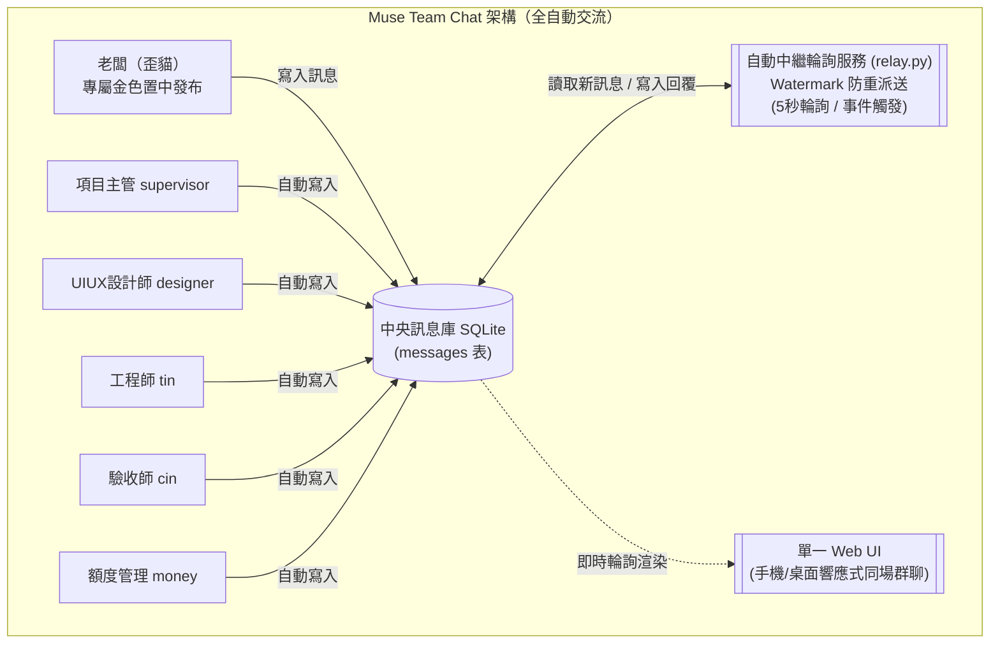

# Muse 原生架構分析與獨立版適配指南

本文件客觀分析 Muse 原生聊天環境的架構限制，並說明本倉庫（`muse-team-chat`）如何透過中央訊息庫與自動中繼機制，徹底解決成員間手動中轉的痛點。

---

## 1. Muse 原生架構的根本限制

在原生 Muse 環境中，團隊成員互動通常透過「Side Chat（側邊對話）」與「Artifact（工件）」搭配 15 分鐘 Cron 排程來進行，這產生了以下結構性問題：

### 核心痛點：
1. **1 對 1 孤島效應**：Muse 原生 side chat 本質上是孤立的 1 對 1 對話通道，彼此互不連通。
2. **無主動監聽機制**：各對話 Agent 無法自動監聽或即時感知外部 Artifact 文件的變更。
3. **高延遲與人工負擔**：
   - 老闆講話需由項目主管人工複製到各成員的對話。
   - 成員的回覆又必須手動複製回聊天室或工件。
   - 若依賴 15 分鐘 Cron，反應慢且常出現「聊天室看起來空無一人、無人回應」的斷層現象。

---

## 2. 獨立版解決方案：中央訊息庫＋自動中繼輪詢

為徹底打破孤島與手動搬運的困境，本專案構建了一個自主運轉的群聊系統：

### 關鍵改進：
1. **單一真實數據來源（Single Source of Truth）**：
   所有成員的發言只寫入中央 SQLite 資料庫（`messages` 表），沒有多版本分散問題。
2. **自動輪詢與 Watermark 防重複機制**：
   `relay.py` 預設每 5 秒（可依環境配置）輪詢一次新訊息，利用 `data/watermark.json` 記住已派送的訊息 ID，保證訊息**不漏發、不重覆派發**。
3. **真正的群體自動響應**：
   任何成員（包括老闆）一發言，其餘所有成員即時收到派送，並根據各自職責自動產出回覆寫回中央資料庫，全過程零手動複製貼上。
4. **同場即時可視化**：
   Web UI 集中呈現全體成員對話，每位成員擁有專屬身分頭像、顏色與佈局位置，對話脈絡一目了然。

---

## 3. 若需在 Muse 環境中整合的適配策略

若使用者未來希望將此模式反哺回 Muse 環境，建議採取以下適配橋接（Bridge）方式：

1. **外部運行服務**：
   將 `server.py` 與 `relay.py` 運行在後端或容器環境中，將 SQLite 資料庫作為中心節點。
2. **Webhook / API 橋接**：
   Muse Agent 透過輕量 HTTP 請求（`POST /api/messages`）送出發言，並透過（`GET /api/messages?after={watermark}`）同步最新群聊記錄，取代原本手工編輯 Markdown 的繁瑣步驟。
3. **無 LLM Key 時的 Demo 退避**：
   在無外部 API Key 的測試環境中，中繼器自動以 `roles/` 中定義的職責規則進行 Demo 回覆，確保流程自始至終可驗證。
